
<picture><source media="(prefers-color-scheme: dark)" srcset="assets/hero-dark.svg"></picture>

  <a href="https://www.linkedin.com/in/n-v-j-k-kartik-95283823b/">LinkedIn</a> &nbsp;·&nbsp;
  <a href="https://scholar.google.com/citations?user=tc23KVoAAAAJ">Google Scholar</a> &nbsp;·&nbsp;
  <a href="https://dev.to/kartik-nvjk">DEV</a> &nbsp;·&nbsp;
  <a href="https://arxiv.org/abs/2509.14647">arXiv</a> &nbsp;·&nbsp;
  <a href="https://futureagi.com">Future AGI</a>

<picture><source media="(prefers-color-scheme: dark)" srcset="assets/stat-patent-dark.svg">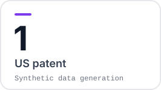</picture> <a href="https://scholar.google.com/citations?user=tc23KVoAAAAJ"><picture><source media="(prefers-color-scheme: dark)" srcset="assets/stat-papers-dark.svg">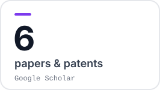</picture></a> <a href="https://github.com/future-agi/traceAI"><picture><source media="(prefers-color-scheme: dark)" srcset="assets/stat-sdk-dark.svg">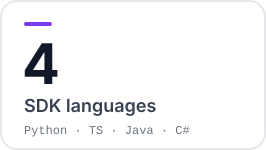</picture></a>

## Open source

<a href="https://github.com/future-agi/future-agi"><picture><source media="(prefers-color-scheme: dark)" srcset="assets/p-future-agi-dark.svg"></picture></a> <a href="https://github.com/future-agi/traceAI"><picture><source media="(prefers-color-scheme: dark)" srcset="assets/p-traceai-dark.svg">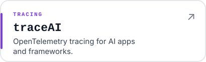</picture></a>

<a href="https://github.com/future-agi/agent-learning-kit"><picture><source media="(prefers-color-scheme: dark)" srcset="assets/p-alk-dark.svg">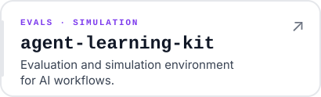</picture></a> <a href="https://github.com/future-agi/agent-opt"><picture><source media="(prefers-color-scheme: dark)" srcset="assets/p-opt-dark.svg">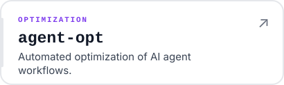</picture></a>

<a href="https://github.com/future-agi/simulate-sdk"><picture><source media="(prefers-color-scheme: dark)" srcset="assets/p-sim-dark.svg">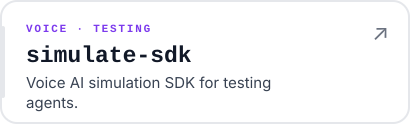</picture></a> <a href="https://github.com/future-agi/futureagi-sdk"><picture><source media="(prefers-color-scheme: dark)" srcset="assets/p-sdk-dark.svg">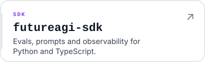</picture></a>

## Papers and patents

<picture><source media="(prefers-color-scheme: dark)" srcset="assets/paper-patent-dark.svg">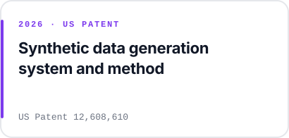</picture> <a href="https://arxiv.org/abs/2509.14647"><picture><source media="(prefers-color-scheme: dark)" srcset="assets/paper-compass-dark.svg">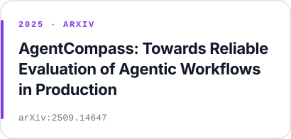</picture></a>

4 earlier papers (education and applied ML)

| Year | Title | Venue |
| --- | --- | --- |
| 2025 | Exploring Emotional Trajectories through Valence and Arousal in Open-Ended Math Learning Environments | APSCE |
| 2025 | Energy-Efficient Depthwise Separable CNNs for Classification and Segmentation of Lung Cancer Nodules | IEEE INDISCON |
| 2024 | Advancing Speaker Diarization With Whisper Speech Recognition for Different Learning Environments | IEEE T4E / TALE |
| 2024 | Unlocking the Triggers: Automating the Identification of Triggers of Socially Shared Metacognitive Regulation in Collaborative Problem-Solving | T4E |

[All papers on Google Scholar](https://scholar.google.com/citations?user=tc23KVoAAAAJ) · IIIT Dharwad

## Writing

[My agent had great traces and still never got better. Here is the loop I built.](https://dev.to/kartik-nvjk/my-agent-had-great-traces-and-still-never-got-better-here-is-the-loop-i-built-15o9)

`Python` `Go` `TypeScript` `Java` `C#` `Django` `React` `PostgreSQL` `ClickHouse` `Redis` `Temporal` `OpenTelemetry` `Docker` `Kubernetes` `GCP`
