  <a href="https://www.linkedin.com/in/n-v-j-k-kartik-95283823b/"><code>linkedin</code></a>
  <a href="https://scholar.google.com/citations?user=tc23KVoAAAAJ"><code>scholar</code></a>
  <a href="https://dev.to/kartik-nvjk"><code>dev.to</code></a>
  <a href="https://arxiv.org/abs/2509.14647"><code>arxiv</code></a>
  <a href="https://futureagi.com"><code>futureagi.com</code></a>

### `~/stack`

`Python` `Go` `TypeScript` `Java` `C#` `Django` `React` `PostgreSQL` `ClickHouse` `Redis` `Temporal` `OpenTelemetry` `Docker` `Kubernetes` `GCP`

### `~/open-source`

| Repo | What it is |
| --- | --- |
| [`future-agi/`](https://github.com/future-agi/future-agi)  | Tracing, evals, simulations, datasets, gateway and guardrails in one self-hostable platform. |
| [`traceAI/`](https://github.com/future-agi/traceAI)  | OpenTelemetry-based tracing for AI apps and frameworks. |
| [`agent-learning-kit/`](https://github.com/future-agi/agent-learning-kit) | Evaluation and simulation environment for AI workflows. |
| [`agent-opt/`](https://github.com/future-agi/agent-opt) | Automated optimization of AI agent workflows. |
| [`simulate-sdk/`](https://github.com/future-agi/simulate-sdk) | Voice AI simulation SDK for testing agents. |
| [`futureagi-sdk/`](https://github.com/future-agi/futureagi-sdk) | Evals, prompt management and observability SDK for Python and TypeScript. |

### `~/papers`

[AgentCompass on arXiv](https://arxiv.org/abs/2509.14647) · [all papers on Google Scholar](https://scholar.google.com/citations?user=tc23KVoAAAAJ)

### `~/writing`

[My agent had great traces and still never got better. Here is the loop I built.](https://dev.to/kartik-nvjk/my-agent-had-great-traces-and-still-never-got-better-here-is-the-loop-i-built-15o9)

IIIT Dharwad
